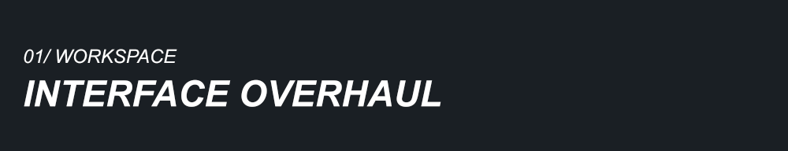
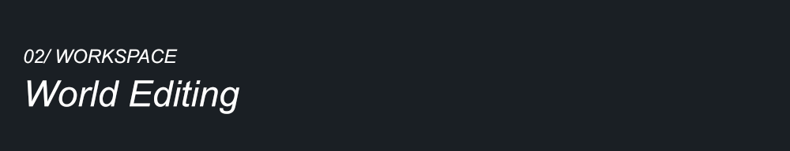
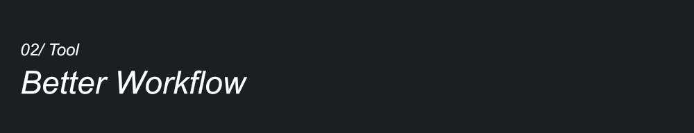

<h1 align="center">RainWright</h1>

<p align="center"><strong>A visual development toolkit for Rain World region creators</strong></p>

<p align="center">
  <a href="./README.md"></a>
  <a href="./README.en.md"></a>
</p>

<p align="center">
  <a href="./LICENSE"></a>
  
  
  <a href="https://github.com/RWRegionModdingCN/RainWright/actions/workflows/ci.yml"></a>
  <a href="https://github.com/RWRegionModdingCN/RainWright/stargazers"></a>
</p>

<p align="center"></p>

---

Creating a Rain World region often means switching between room objects, world connections, creature spawns, maps, and text files.

**RainWright** brings these tasks into one visual workspace. It redesigns the layout and interactions of the vanilla Dev Tools to make region creation and debugging easier to manage.

RainWright is now maintained as an independent project. Its editor, world topology, map backend, fonts, and Cartography atlases are provided by `RainWright.dll`. Neither running nor building it requires DryCycle / Ancient Site.

## Installation and layout

You need Rain World, its developer tools, **Rain World ImGUI API 1.12.0 or later**, and the API's Library Loader. Enable the dependencies and RainWright in Remix, then enable the game's developer tools.

This repository contains source code and Mod resources. Building the complete game DLL requires assemblies from your own Rain World installation. The portable core produced by CI is a development artifact.

```powershell
# Install .NET 10 SDK and PowerShell 7, then run from the repository root.
./scripts/Build.ps1 -RainWorldDir 'D:/Steam/steamapps/common/Rain World'
./scripts/Install.ps1 -RainWorldDir 'D:/Steam/steamapps/common/Rain World'
```

The complete Mod is generated in `artifacts/mod/RainWright/`. You can also copy that directory into the game's `RainWorld_Data/StreamingAssets/mods/`, restart the game, and enable it in Remix.

- `src/`: editor source code and bundled author-path validation utilities.
- `mod/`: Mod metadata, translations, thumbnails, and editable artwork.
- `tests/`: portable regressions, game assembly tests, and validation probes.
- `scripts/`: build, test, installation, and assembly protection commands.
- `docs/`: development notes, dependencies, architecture, and presentation assets.
- `artifacts/`: generated DLLs, installable Mod files, and installation backups; excluded from Git.

See [Building and testing](./docs/BUILDING.md) for configuration and reference assembly details.

## Main features

- **One development workspace** for rooms, objects, sounds, worlds, maps, triggers, and relationships.
- **Visual object editing** with search, filtering, multiple selection, property and resource choices, and draggable scene handles.
- **World connections and creature spawns**, including two-way and one-way links, precise pipe endpoints, and hot reloading.
- **Map authoring** for Player Map and developer layouts, with a Cartography workspace for map elements.
- **Sound management** with custom sound groups and regional sound editing.
- **Editing history and recovery** through undo, redo, automatic save recovery, configurable shortcuts, and workspace presets.
- **Content Mod authoring** that writes changes to vanilla regions as standard Remix `modify/world/` patches.

<p align="center"></p>
<p align="center"></p>
<p align="center"></p>

## Start editing

After entering a region, open the developer tools and use **Edit Target Mod...** in the top bar to select your content Mod before editing and saving. Reapply Mods through Remix when validating patches to vanilla or other Mods' regions.

Unsaved room, object, sound, and trigger edits remain in the editing session. Topology metadata lives in the target Mod's `world/WorldTopology.json`; personal settings live in `BepInEx/config`.

Run `./scripts/Test.ps1` for regressions that do not require the game. See [Building and testing](./docs/BUILDING.md) and [Architecture](./docs/ARCHITECTURE.md) for the complete build, game assembly tests, and extension boundaries.

## License and acknowledgements

The project uses the [Apache-2.0 license](./LICENSE). Third-party fonts and assets retain their own licensing and attribution; see [Third-party notices](./THIRD_PARTY_NOTICES.md).

---

<div align="center">
  <p>If this project helps you, consider giving it a <strong>Star</strong>.</p>
  <a href="https://github.com/RWRegionModdingCN/RainWright/stargazers">Star RainWright on GitHub</a>
</div>
